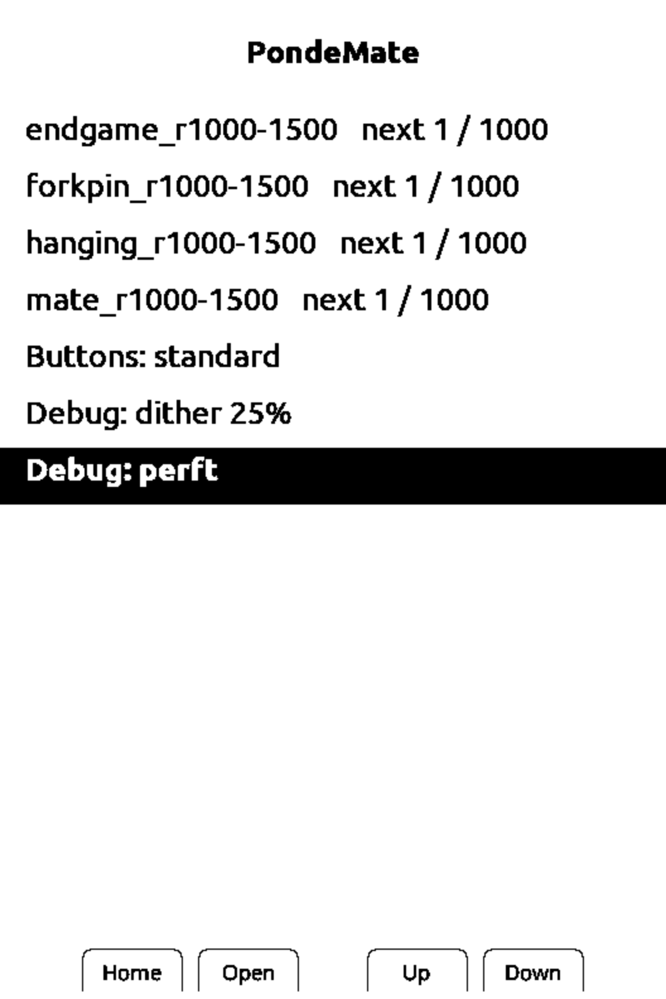
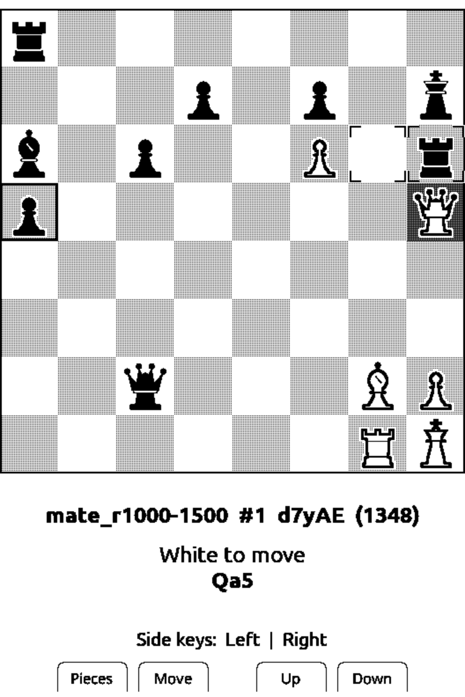
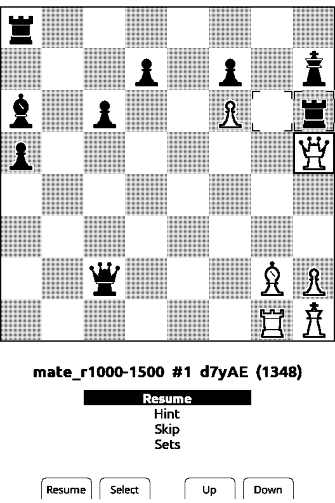
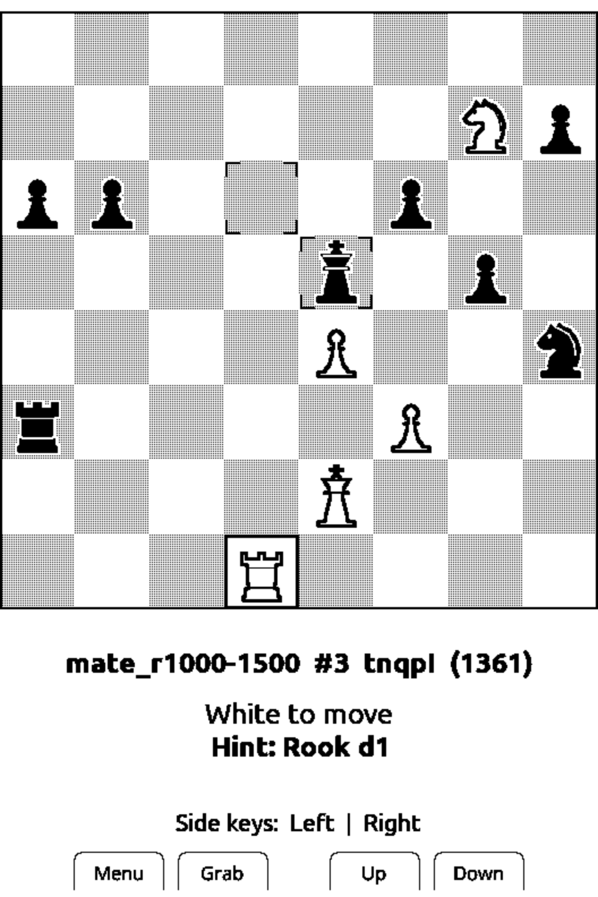

# PondeMate

Chess puzzle firmware for the **XTEINK X3** e-ink reader — a fork of
[CrossPoint Reader](https://github.com/crosspoint-reader/crosspoint-reader) 1.6.5.

PondeMate adds a puzzle player to CrossPoint: pick a set of lichess puzzles from
the SD card, move pieces with a cursor that snaps to legal choices, and keep
going until the set is done. Everything else in CrossPoint (the reader, Wi-Fi
transfer, settings) is still there. CrossPoint's own README is kept at
[docs/CROSSPOINT_README.md](docs/CROSSPOINT_README.md).

> **Unofficial and unsupported.** PondeMate is a personal hobby project. It is
> not affiliated with, endorsed by or supported by XTEINK or the CrossPoint
> Reader project. It comes with no warranty, as stated in the MIT License.
> Issues and pull requests may not get a response. Flashing custom firmware is
> at your own risk.

| Set picker | Choosing a destination | In-puzzle menu | Hint |
|---|---|---|---|
|  |  |  |  |

Screenshots are from the CrossPoint simulator (2× scale), not photos of the device.

## Features

- **Puzzle sets on the SD card** — `/pondemate/sets/*.txt`, one puzzle per
  256-byte line. Four sets of 1,000 lichess puzzles (rating 1000–1500) are
  included: mate in 1–2, hanging piece, fork/pin, endgame.
- **Snap cursor** — Left/Right pick a file that has a movable piece (or a legal
  destination), Up/Down pick a square within that file. Both wrap around.
  The same two moves work for choosing the piece and its destination.
- **See what happened** — after a correct move your move stays on the board for
  a second before the opponent's reply appears. The last move is marked with
  corner brackets.
- **Hint and Skip** — press Back while choosing a piece to open a small menu:
  Resume / Hint (shows which piece to move, not where) / Skip / Sets.
- **Progress and log** — each set remembers the next puzzle; every solved or
  skipped puzzle is appended to `/pondemate/log.txt` with mistakes and hints.
- **Two button layouts** — standard, or hjkl (front buttons as h/j/k/l).
- **Board shading** — dark squares at 25% (default) or 50% dither.
- Screen changes use a half refresh so the previous screen does not linger.

## Controls

The X3 has four buttons on the front (1–4, left to right) and two on the sides:
Up on the left side of the device and Down on the right side.

| Button | Standard | hjkl |
|---|---|---|
| Front 1 | Back / menu | Left (h) |
| Front 2 | OK (grab, move, select) | Down (j) |
| Front 3 | Up | Up (k) |
| Front 4 | Down | Right (l) |
| Side, left (Up) | Left | OK |
| Side, right (Down) | Right | Back / menu |

In the set picker, Up/Down choose a row and OK opens it. The picker also holds
the settings: `Buttons` (standard / hjkl), `Debug: dither 25% / 50%`,
`Debug: reset progress` (asks for confirmation; clears every set's progress,
keeps `log.txt`) and `Debug: perft` (move-generator self test).

## SD card layout

```
/pondemate/
  sets/          puzzle sets, *.txt (from sdcard/pondemate/sets/ in this repo)
  progress/      <set name>.txt — index of the next puzzle (written by the device)
  log.txt        one line per solved or skipped puzzle (append only)
  settings.txt   buttons=standard|hjkl, dither=25|50
```

`log.txt` columns, tab separated:

```
set  index  puzzle_id  rating  mistakes  hints  result
```

`result` is `solved` or `skip`; `index` is 0-based. (Logs written by very early
builds have only the first five columns.)

## Install

1. **Back up the original firmware first** (the whole 16 MB flash, once):
   ```sh
   esptool.py --chip esp32c3 --port <port> read_flash 0x0 0x1000000 x3_backup.bin
   ```
2. Download `pondemate-v0.1.0-x3.bin` and `pondemate-v0.1.0-sdcard.zip` from
   [Releases](https://github.com/kikyujin/PondeMate/releases).
3. Flash the firmware with one of:
   - the CrossPoint web flasher: https://crosspointreader.com/#flash-tools → X3 →
     "Custom .bin";
   - esptool:
     ```sh
     esptool.py --chip esp32c3 --port <port> --baud 921600 write_flash 0x10000 pondemate-v0.1.0-x3.bin
     ```
4. Unzip `pondemate-v0.1.0-sdcard.zip` to the root of the SD card, so that the
   card has `/pondemate/sets/*.txt`.

**USB-locked devices:** some X3 units sold by third-party stores ship with USB
flashing locked. CrossPoint's README describes an unlocker tool; PondeMate has
not been tested with it.

**Updates:** Settings → "Check for Updates" is removed in PondeMate (it would
fetch upstream CrossPoint and replace this firmware). Download new versions from
Releases and flash them yourself. The firmware version shown in Settings and
About is still CrossPoint's (1.6.5).

**Going back:** write your backup over the whole flash:

```sh
esptool.py --chip esp32c3 --port <port> write_flash 0x0 x3_backup.bin
```

or flash an official CrossPoint release with the web flasher.

## Building

PondeMate builds with PlatformIO like CrossPoint. Pinned versions:

| Component | Version |
|---|---|
| CrossPoint Reader base | tag `1.6.5` (`93e98bb7`) |
| ChessCore (from CrossPlay) | `0a1d17f` (CrossPlay v1.14.2) |
| pioarduino core | 6.1.19 (6.2.0 fails: SCons 4.11.1 lacks `SCons.Tool.FortranCommon`) |
| platform-espressif32 | 55.03.311 (as in `platformio.ini`) |

```sh
git clone --recursive https://github.com/kikyujin/PondeMate.git
cd PondeMate
pio run -e gh_release            # release build (the Release firmware.bin)
pio run -e default -t upload     # development build with debug logging, flash over USB
```

Host tests (no device needed):

```sh
test/host/chess/run.sh
test/host/pondemate/run.sh "$PWD/sdcard/pondemate/sets"   # the script changes directory; pass an absolute path
```

## Making puzzle sets

`tools/pondemate/` picks puzzles from the
[lichess puzzle database](https://database.lichess.org/#puzzles)
(`pick.py`), reports statistics (`stats.py`) and checks every picked puzzle
with the same ChessCore the device runs (`validate.sh`). See
[tools/pondemate/README.md](tools/pondemate/README.md).

The piece bitmaps are generated by `tools/pondemate/pieces/` (drawn for this
project).

## Credits and licenses

- **CrossPoint Reader** — MIT, © 2025 CrossPoint Reader organization. PondeMate
  keeps CrossPoint's history and license; see [`LICENSE`](LICENSE).
- **ChessCore / ChessEngine** (`lib/ChessCore/`) — from
  [CrossPlay](https://github.com/ma-r-s/crossplay) (commit `0a1d17f`) by Mario
  Ruiz, MIT. See [`lib/ChessCore/LICENSE`](lib/ChessCore/LICENSE).
- **FreeInk SDK** (`freeink-sdk/`, submodule) — MIT, with its own third-party
  notices (`freeink-sdk/NOTICE`).
- **Fonts** — Noto Sans / Noto Serif / OpenDyslexic (SIL OFL 1.1) and Ubuntu
  (Ubuntu Font Licence 1.0), see `lib/EpdFont/builtinFonts/source/`.
- **Puzzles** — the [lichess.org puzzle database](https://database.lichess.org/#puzzles),
  released under CC0. Thank you, lichess!
- **Piece artwork** — drawn for PondeMate, MIT.

Everything bundled in the firmware and the repository is listed in
[THIRD_PARTY_NOTICES.md](THIRD_PARTY_NOTICES.md).
PondeMate's own changes are released under the MIT License, like CrossPoint.

Built with the help of Claude Code (Anthropic).

---

## 日本語

PondeMate は、XTEINK X3 をチェスパズル専用機にするファームウェアです。
CrossPoint Reader 1.6.5 のフォークで、読書機能はそのまま残っています。
lichess の問題（CC0）を4セット×1000問同梱。左右でファイル、上下でマスを選ぶ
カーソル、ヒント・パス、進み具合とログに対応しています。

設定の「Check for Updates」（更新の確認）は外してあります。新しい版は Releases から
落として、自分で書き込んでください。設定に出る版の表示は CrossPoint 1.6.5 のままです。

個人の趣味の非公式なプロジェクトで、XTEINK・CrossPoint Reader とは関係ありません。
MIT ライセンスのとおり無保証です。Issue や Pull Request には応えられないことがあります。
書き込みは自己責任で、必ず純正ファームのバックアップを取ってから行ってください。
